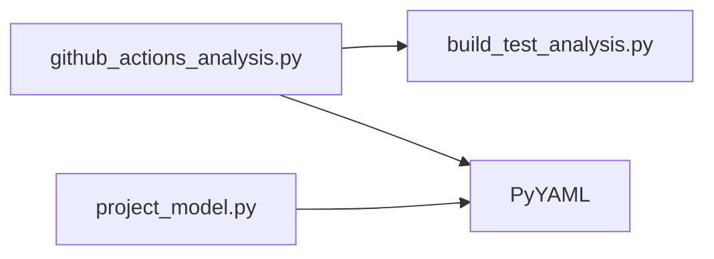

# Importberoenden och bevarandegate för domänmotorn

Datum: 2026-10-27. Källor: samtliga 18 `scripts/lib/*.py` på `main` (exklusive `__init__.py`). Detta är en **statisk kontroll av direkta importuttryck**, inte en körd testsvit, fullständig dynamisk call graph eller runtimeparitetsverifiering.

## Direkt importgraf

- `scripts/lib/github_actions_analysis.py` importerar `analyze_build_test` från `scripts.lib.build_test_analysis`.
- De övriga 17 granskade modulerna har inga explicit `scripts.lib.*`-importer på modulnivå.
- `scripts/lib/github_actions_analysis.py` och `scripts/lib/project_model.py` importerar tredjepartsmodulen `yaml` (PyYAML).
- Övriga toppnivåimporter i de 18 filerna ser ut att använda standardbiblioteket, exempelvis `pathlib`, `urllib.parse` och `tomllib`.

Kontrollen gäller **importuttryck**. Dynamiska importer, funktioners anrop till andra moduler och samverkan genom fil- och JSON-kontrakt omfattas inte. Därför är låg koppling i detta underlag inte ett tillstånd att gallra filer.

## Bevarandebeslut

1. Behåll hela `scripts/lib/` i nästa implementation; `__init__.py` ligger kvar som paketmarkör.
2. För varje Skill, registrera samtliga direkt importerade Python-moduler och de JSON-scheman, mallar, Knowledge-filer och arbetsytor som dess operationer behöver.
3. Skilj `scripts/lib/` (domänmotor) från `scripts/build_distributions.py` med flera (legacy-distributionsverktyg).
4. Ta inte bort projektets egna smoke-validatorer innan deras unika assertioner extraherats till oberoende regressionstester.
5. Före aktivering av `skills.resource_policy: explicit` ska en faktisk packageringskontroll visa att Skill-filerna kan importera sina beroenden i isolerade paket.

## Ej verifierat

- Fulla funktionsanrop och indirekta filberoenden.
- Importer från tester, top-level-script och genererade runtime-artifakter.
- Pytest-resultat och kanoniskt GPT Byggaren 1.6.33-build.
- Runtimekompatibilitet i Chat, Plugin, Claude Projects, Claude Skills och OpenCode.

**Nästa steg:** efter merge av PR #6 skapas separat implementations-PR för canonical core, Skills och projektmodell. Använd det här dokumentet som första importgate; komplettera med körd verifiering före någon radering eller release-statusändring.
